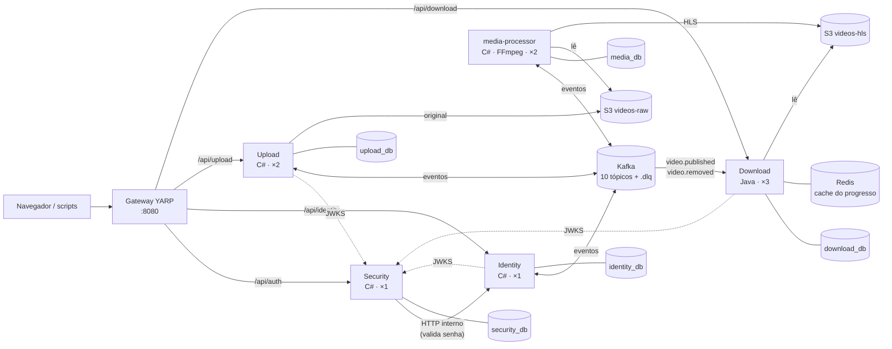
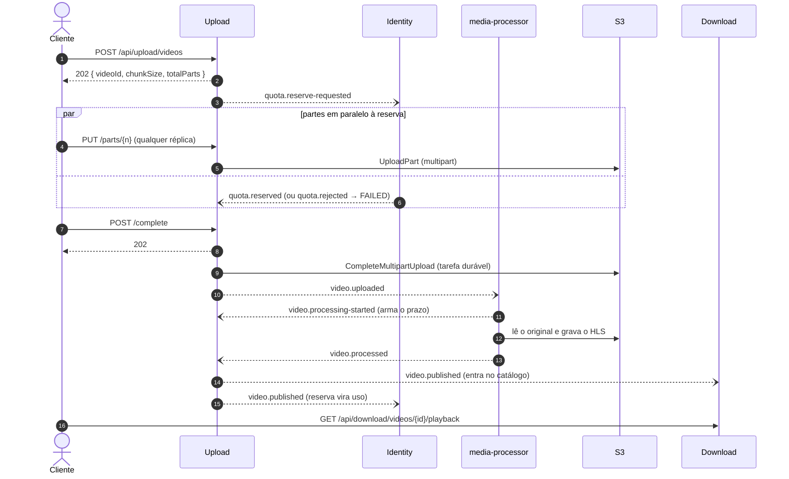
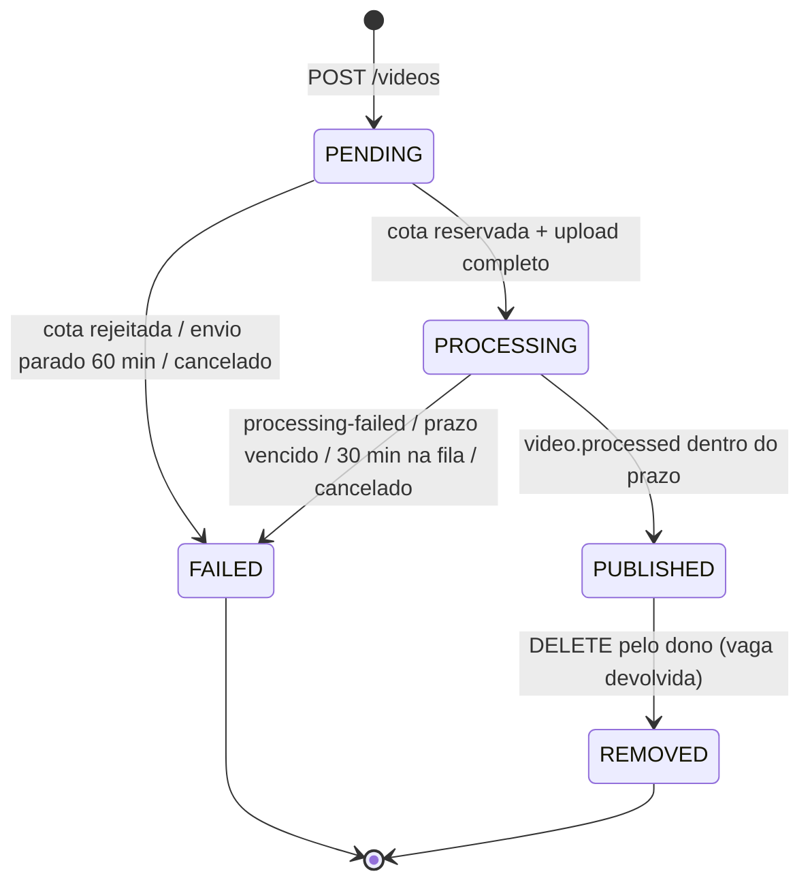

# YoutubeSD — Arquitetura e decisões

Documento de referência do trabalho final de Sistemas Distribuídos (FURB). Explica o que o
sistema faz, como as partes se encaixam e por que cada decisão foi tomada. Para subir o
ambiente, veja [COMO-INICIAR.md](COMO-INICIAR.md). Detalhes de API e configuração de cada
serviço ficam nos READMEs de [Identity](../services/identity/README.md),
[Security](../services/security/README.md) e [Upload](../services/upload/README.md).

## Sumário

1. [Definição do projeto](#1-definição-do-projeto)
2. [Mapa do sistema](#2-mapa-do-sistema)
3. [Serviços](#3-serviços)
4. [Fluxos principais](#4-fluxos-principais)
5. [Mensageria e contratos](#5-mensageria-e-contratos)
6. [Decisões e justificativas](#6-decisões-e-justificativas)
7. [Requisitos e cenários de falha](#7-requisitos-e-cenários-de-falha)
8. [Limitações conhecidas](#8-limitações-conhecidas)

---

## 1. Definição do projeto

**O que é.** O YoutubeSD é uma plataforma de vídeo sob demanda. O usuário se cadastra, envia
um vídeo, o sistema converte o arquivo para streaming adaptativo (HLS) e o publica num
catálogo, onde ele pode ser assistido e retomado de onde parou.

**Para que serve no trabalho.** O domínio é o pretexto. O objetivo é exercitar, num fluxo real,
os problemas clássicos de sistemas distribuídos:

- várias réplicas do mesmo serviço, que podem morrer a qualquer momento;
- comunicação assíncrona entre serviços que não estão sempre no ar;
- um recurso escasso (a cota de uploads) disputado em paralelo;
- uma operação de negócio que atravessa vários serviços e precisa ser desfeita quando falha;
- dependências lentas ou instáveis;
- mensagens repetidas, fora de ordem ou corrompidas.

**Escopo.**

| Dentro | Fora |
|---|---|
| Cadastro, login e renovação de sessão | Busca, recomendação, comentários |
| Upload em partes, retomável, de qualquer tamanho (até 10 GiB) | CDN real e DRM |
| Conversão para HLS em 360p e 720p, com miniatura | Implantação em nuvem (tudo roda local; o S3 é emulado) |
| Catálogo, reprodução e "continuar assistindo" | Interface final (o frontend Angular ainda é um esqueleto no branch `frontend`) |
| Cota de uploads por usuário | |
| Roteiro de falhas reproduzível (F1 a F8) | |

**Princípios que guiaram as escolhas.**

1. Nenhuma réplica guarda estado em memória: qualquer uma pode cair sem perder nada.
2. Toda mensagem pode chegar repetida, atrasada ou fora de ordem: quem consome se protege.
3. Estado e evento mudam juntos ou não mudam (sem escrita dupla).
4. Cada serviço é dono dos seus dados; ninguém lê o banco do outro.
5. Toda garantia tem um teste ou script que a demonstra.

---

## 2. Mapa do sistema

### 2.1 Componentes



Os cinco bancos ficam numa única instância MySQL, mas são bancos separados e sem chave
estrangeira entre eles. O S3 é emulado pelo MiniStack. As linhas tracejadas são a busca da
chave pública do JWT, feita uma vez e guardada em cache.

### 2.2 Quem fala com quem

| Origem → destino | Meio | Para quê |
|---|---|---|
| Cliente → gateway | HTTP | Toda entrada externa passa pela porta 8080 |
| Gateway → serviços | HTTP (YARP) | Roteia pelo prefixo `/api/<serviço>`, balanceia e afasta réplica doente |
| Security → Identity | HTTP interno com `X-Internal-Key` | Confere a senha no login e relê o papel do usuário a cada refresh |
| Identity, Upload, Download → Security | HTTP (JWKS, com cache) | Chave pública para validar o JWT localmente |
| Upload ↔ Identity | Kafka | Reservar e devolver vaga da cota |
| Upload ↔ media-processor | Kafka | Pedir o processamento e receber o resultado |
| Upload → Download e Identity | Kafka | Avisar que um vídeo foi publicado ou removido |

### 2.3 Mapa do repositório

```
Orchestrador/YoutubeOrchestrador/
  YoutubeOrchestrador.AppHost/          orquestração local com .NET Aspire (réplicas, portas, segredos)
  YoutubeOrchestrador.Gateway/          gateway YARP
  YoutubeOrchestrador.ServiceDefaults/  health check, OpenTelemetry e validação de JWT dos serviços .NET
services/
  security/    login, emissão de JWT RS256, JWKS e refresh (C#)
  identity/    usuários e cota de uploads (C#)
  upload/      API de upload e saga (upload/), FFmpeg (media-processor/), base comum (upload.messaging/)
  download/    catálogo, entrega HLS e progresso (Java, Spring Boot)
contracts/     JSON Schema do envelope e de cada evento, com exemplos
infra/
  kafka/       criação dos tópicos e das DLQs
  ministack/   criação dos buckets do S3
  upload/      script de envio de vídeo pelo gateway
  seed/        vídeo de exemplo publicado direto no catálogo
  falhas/      roteiro dos cenários de falha
deploy/        docker-compose.yaml gerado a partir do AppHost
docs/          este documento e o guia de início
```

### 2.4 Endereços locais

| O quê | Endereço |
|---|---|
| Gateway (única entrada) | http://localhost:8080 |
| Dashboard do Aspire | http://localhost:15006 (AppHost) ou http://localhost:18888 (Compose) |
| Kafka UI | http://localhost:8090 |
| Download, réplicas | http://localhost:8401, 8402, 8403 (Swagger em `/swagger-ui/index.html`) |
| Upload, réplicas | http://localhost:8501, 8502 |
| media-processor, réplicas (só `/health`) | http://localhost:8601, 8602 |
| MySQL / Redis / Kafka / S3 | 3306 / 6379 / 9092 / 4566 |

---

## 3. Serviços

### Gateway (YARP)
- **Faz:** recebe todas as requisições externas e encaminha `/api/auth`, `/api/identity`,
  `/api/upload` e `/api/download` para o serviço dono.
- **Resiliência:** balanceamento round-robin; health check ativo a cada 5 s (duas falhas
  seguidas tiram a réplica) e passivo por taxa de falha de transporte (volta após 10 s).
- **Segurança:** devolve 404 para `/api/identity/internal/**`, que só existe para o Security.

### Security (C#, .NET 10)
- **Faz:** login, emissão de access token JWT RS256 (15 min) e refresh token (sessão absoluta de
  7 dias), publicação da chave pública em `/api/auth/.well-known/jwks.json`.
- **Dados:** `security_db` com `auth_sessions` e `refresh_tokens` (só o hash SHA-256 do token).
- **Não guarda senha:** quem confere a senha é o Identity, pela API interna.
- **Não usa Kafka.**

### Identity (C#, .NET 10)
- **Faz:** cadastro e perfil de usuários (senha com PBKDF2) e é o dono da cota de uploads
  (10 vagas por usuário por padrão).
- **Dados:** `identity_db` com `users`, `quotas`, `quota_reservations`, `processed_messages`, `outbox`.
- **Consome:** `quota.reserve-requested`, `quota.release-requested`, `video.published`.
- **Publica (via outbox):** `quota.reserved`, `quota.rejected`.

### Upload (C#, .NET 10, 2 réplicas)
- **Faz:** recebe o arquivo em partes de 8 MiB, monta o original no S3 e orquestra a saga do
  vídeo até a publicação ou a compensação. Também lista uploads, cancela, remove e guarda
  notificações para o usuário.
- **Dados:** `upload_db` (EF Core, uma migration por tabela) e o bucket `videos-raw`.
- **Consome:** `quota.reserved`, `quota.rejected`, `video.processing-started`,
  `video.processed`, `video.processing-failed`.
- **Publica (via outbox):** `quota.reserve-requested`, `quota.release-requested`,
  `video.uploaded`, `video.published`, `video.removed`.

### media-processor (C#, .NET 10, FFmpeg, 2 réplicas)
- **Faz:** consome `video.uploaded`, baixa o original, roda `ffprobe` e um único comando FFmpeg
  que gera HLS em 360p e 720p e a miniatura, e grava tudo em `videos-hls/{videoId}/`.
- **Dados:** `media_db` com `processing_job` (tentativas, réplica, último erro) e
  `chaos_settings` (falha e latência simuladas, alteráveis ao vivo).
- **Publica (via outbox):** `video.processing-started`, `video.processed`, `video.processing-failed`.
- **Sem rota no gateway:** só expõe `/health`.

### Download (Java 25, Spring Boot 4, 3 réplicas)
- **Faz:** mantém o catálogo a partir dos eventos, entrega o HLS (playlists e segmentos lidos do
  S3), aplica a visibilidade (`PUBLIC`, `UNLISTED`, `PRIVATE`) e guarda o progresso de
  reprodução e a lista "continuar assistindo".
- **Dados:** `download_db` (Flyway) com `video_catalog`, `playback_progress`,
  `processed_messages`; Redis como cache do progresso.
- **Consome:** `video.published`, `video.removed`.

---

## 4. Fluxos principais

### 4.1 Do upload à publicação



O vídeo só vai para processamento quando as duas condições valem: cota `RESERVED` e upload
`COMPLETED`. O que chegar por último dispara o `video.uploaded`.

### 4.2 Estados da saga e compensações



Ao entrar em `FAILED`, a saga compensa: publica `quota.release-requested` (a vaga volta ao
Identity), aborta o multipart e agenda a remoção do original e do HLS no S3. Se o resultado do
processamento chegar depois do prazo, o HLS gerado é apagado e nada é publicado.

| Prazo | Padrão | O que acontece quando vence |
|---|---|---|
| Fila sem nenhum processor | 30 min | `FAILED (QUEUE_TIMEOUT)` e compensação |
| Processamento por tentativa | 60 s + 1 s por MB, re-armado a cada `processing-started` | `FAILED (DEADLINE_EXPIRED)` e compensação |
| Envio parado | 60 min | Upload abandonado e compensação |
| Tentativas do processor | 3, somadas entre as réplicas | `video.processing-failed` |

### 4.3 Login e renovação de sessão

1. `POST /api/auth/login` → o Security chama `POST /api/identity/internal/authenticate` no Identity.
2. Senha correta → o Security cria a sessão e devolve `accessToken` (JWT RS256, 15 min) e `refreshToken`.
3. Os serviços validam o JWT sozinhos (assinatura, emissor, audiência, expiração) com a chave
   pública do JWKS, guardada em cache. O dono de cada recurso é a claim `sub`.
4. `POST /api/auth/refresh` troca o refresh por um par novo, numa transação que bloqueia a sessão.
   Reusar um refresh já trocado revoga a sessão inteira.

### 4.4 Reprodução e progresso

1. `GET /api/download/videos` lista o catálogo público.
2. `GET /api/download/videos/{id}/playback` confere a visibilidade e devolve a URL do
   `master.m3u8` e a posição de onde retomar.
3. O player pede playlists e segmentos `.ts` ao Download, que confere o acesso e lê do S3.
4. `PUT /api/download/progress/{id}` grava a posição com o horário do cliente (`clientTs`).
   Vence sempre o `clientTs` mais novo, no MySQL e no Redis. Acima de 95% o vídeo conta como
   assistido.

---

## 5. Mensageria e contratos

### 5.1 Envelope

Toda mensagem no Kafka usa o mesmo envelope ([contracts/envelope.schema.json](../contracts/envelope.schema.json)):

```json
{
  "messageId": "uuid único — base da idempotência",
  "correlationId": "id da saga (o videoId), igual do início ao fim",
  "type": "VideoPublished",
  "version": 1,
  "occurredAt": "2026-11-24T12:00:00Z",
  "payload": { }
}
```

A chave da mensagem no Kafka é o `videoId`. Assim, todos os eventos de um vídeo caem na mesma
partição e chegam em ordem ao consumidor.

### 5.2 Tópicos

Todos com 3 partições e um `<tópico>.dlq` correspondente ([infra/kafka/create-topics.sh](../infra/kafka/create-topics.sh)).

| Tópico | Publica | Consome |
|---|---|---|
| `quota.reserve-requested` | Upload | Identity |
| `quota.reserved` | Identity | Upload |
| `quota.rejected` | Identity | Upload |
| `quota.release-requested` | Upload | Identity |
| `video.uploaded` | Upload | media-processor |
| `video.processing-started` | media-processor | Upload |
| `video.processed` | media-processor | Upload |
| `video.processing-failed` | media-processor | Upload |
| `video.published` | Upload | Download, Identity |
| `video.removed` | Upload | Download |

### 5.3 O que todo consumidor faz

```
recebe a mensagem
  ├─ fora do contrato? ── tenta 3 vezes ── vai para <tópico>.dlq e confirma o offset
  ├─ messageId já em processed_messages? ── ignora e confirma (log "duplicada ignorada")
  └─ numa única transação: aplica o efeito + grava processed_messages + grava eventos no outbox
        └─ só então confirma o offset no Kafka
MySQL ou S3 fora do ar? ── espera e tenta de novo; não manda para a DLQ
```

---

## 6. Decisões e justificativas

Cada decisão traz o motivo, a alternativa mais óbvia e o custo que aceitamos ao escolher.

### 6.1 Arquitetura

#### D1. Um serviço por capacidade de negócio
- **Decisão:** Security, Identity, Upload, media-processor e Download, cada um com uma
  responsabilidade e o próprio banco.
- **Por quê:** cada parte escala e falha de forma diferente. O Download recebe muito mais
  leitura que o Upload; o FFmpeg consome CPU por minutos; o login é curto e frequente. Separar
  permite réplicas e limites de recurso próprios e deixa a falha de um sem derrubar os outros.
- **Em vez de:** um monólito com módulos.
- **Custo:** consistência eventual entre serviços e mais infraestrutura para subir.

#### D2. Uma única porta de entrada com YARP
- **Decisão:** o cliente só conhece `localhost:8080`; o gateway roteia por prefixo.
- **Por quê:** esconde quantas réplicas existem e onde estão; centraliza balanceamento e health
  check; dá ao cliente um endereço só; bloqueia rotas internas num ponto só. YARP é .NET e se
  integra ao service discovery do Aspire.
- **Em vez de:** o cliente chamar cada serviço na sua porta, ou Nginx com configuração estática.
- **Custo:** o gateway vira ponto único de falha no ambiente local. Ele não guarda estado e
  poderia ter réplicas atrás de um balanceador.

#### D3. Download em Java, o resto em C#
- **Decisão:** o Download usa Spring Boot; os demais, ASP.NET Core.
- **Por quê:** prova que a integração não depende da linguagem. O Download lê os mesmos eventos
  (JSON Schema) e valida o mesmo JWT (JWKS padrão) que os serviços C# sem nenhuma biblioteca
  compartilhada.
- **Em vez de:** tudo em uma linguagem, com um pacote comum de contratos.
- **Custo:** duas toolchains (dotnet e Maven) e regras como idempotência escritas duas vezes.

### 6.2 Dados

#### D4. Banco por serviço, sem chave estrangeira entre serviços
- **Decisão:** `security_db`, `identity_db`, `upload_db`, `media_db` e `download_db`. O Security
  não lê `users`; o Download não lê `video_upload`.
- **Por quê:** um serviço pode mudar o próprio schema sem quebrar o outro, e o dado tem um dono
  claro. O que outro serviço precisa chega por evento (o catálogo do Download é montado a
  partir de `video.published`) ou por API (o Security pergunta ao Identity).
- **Em vez de:** um banco compartilhado com joins.
- **Custo:** dado duplicado (título e dono do vídeo existem no Upload e no Download) e
  atualização eventual. No ambiente local os cinco bancos ficam numa instância MySQL só, por
  economia; a separação é lógica.

#### D5. Binário no S3, metadado no MySQL
- **Decisão:** original em `videos-raw`, HLS em `videos-hls`; o MySQL guarda só chaves e estado.
- **Por quê:** arquivos de gigabytes não cabem bem num banco relacional, e o S3 tem upload
  multipart nativo, que é a base do envio em partes (D14).
- **Em vez de:** disco local da réplica (some quando ela morre) ou BLOB no banco.
- **Custo:** apagar arquivo e mudar estado não são atômicos. Por isso as limpezas viram tarefas
  duráveis na tabela `storage_cleanup`, executadas por qualquer réplica.

#### D6. Redis só como cache do progresso
- **Decisão:** o MySQL é a fonte da verdade; o Redis roda sem persistência (`tmpfs`) e com
  timeout de 200 ms. A gravação no Redis é um script Lua que só substitui o valor se o
  `clientTs` for mais novo.
- **Por quê:** o player manda progresso a cada poucos segundos, e ler do Redis alivia o MySQL.
  Se o Redis cair, o Download continua respondendo pelo MySQL. O Lua torna a comparação e a
  escrita uma operação atômica, sem corrida entre réplicas.
- **Em vez de:** progresso só no Redis com persistência.
- **Custo:** cada gravação vai aos dois lugares. O Redis está fora do health check do Download
  para que uma falha dele não tire réplicas do ar.

### 6.3 Comunicação e confiabilidade

#### D7. Eventos no Kafka entre serviços
- **Decisão:** Upload, Identity, media-processor e Download conversam por tópicos. HTTP entre
  serviços só no login (Security → Identity) e na busca do JWKS.
- **Por quê:** quem publica não precisa que o outro esteja no ar. Com o Kafka, o vídeo espera na
  fila enquanto nenhum media-processor está rodando, e o catálogo se atualiza quando o
  Download volta. Partições e consumer groups dão escala horizontal sem coordenação extra, e o
  log retém as mensagens para reprocessar.
- **Em vez de:** chamadas REST síncronas em cadeia, em que a queda de um serviço falha a operação
  inteira.
- **Custo:** consistência eventual e entrega "pelo menos uma vez", que obriga a idempotência (D9).
  O broker local tem `replication-factor 1`.

#### D8. Envelope comum e contratos em JSON Schema
- **Decisão:** todos os eventos usam o mesmo envelope, cada payload tem um schema versionado em
  `contracts/` com exemplo, e a chave da mensagem é o `videoId`.
- **Por quê:** C# e Java leem a mesma especificação. O `messageId` permite a idempotência, o
  `correlationId` permite seguir uma saga pelos logs de todos os serviços, e o `version` permite
  evoluir um payload sem quebrar quem consome. A chave `videoId` mantém os eventos de um vídeo em
  ordem na mesma partição.
- **Em vez de:** Avro com Schema Registry, mais rígido e com mais uma peça de infraestrutura.
- **Custo:** a validação é feita no código de cada consumidor, não pelo broker.

#### D9. Idempotência gravada na mesma transação do efeito
- **Decisão:** antes de aplicar uma mensagem, o consumidor grava o `messageId` em
  `processed_messages` (chave primária) na mesma transação do efeito. O offset só é confirmado
  depois do commit, nunca automaticamente.
- **Por quê:** o Kafka entrega pelo menos uma vez: depois de uma queda ou de um rebalance a mesma
  mensagem volta. Gravando o `messageId` junto com o efeito, ou os dois ficam ou nenhum fica;
  a segunda entrega bate na chave primária e é ignorada. O resultado prático é efeito único.
- **Em vez de:** checar antes e gravar depois em transações separadas (janela para duplicar), ou
  depender do "exactly once" do Kafka, que não cobre o efeito no MySQL.
- **Custo:** a tabela `processed_messages` cresce e precisaria de limpeza periódica num ambiente
  real.

#### D10. Transactional outbox
- **Decisão:** nenhum serviço publica no Kafka dentro da regra de negócio. O evento é gravado na
  tabela `outbox`, na mesma transação da mudança de estado, e um processo de fundo publica e
  marca `published_at`. No Upload e no media-processor, só uma réplica publica por vez, eleita
  por um lease em tabela de 15 s.
- **Por quê:** evita a escrita dupla. Sem o outbox, o serviço poderia gravar o estado e cair
  antes de publicar (evento perdido) ou publicar e falhar no commit (evento sem estado). Com o
  Kafka fora do ar, os eventos ficam pendentes e saem quando ele volta (F6). O líder único
  mantém a ordem de publicação por id; se ele morrer, outra réplica assume quando o lease vence.
- **Em vez de:** publicar direto no Kafka após o commit, ou transação distribuída (2PC), que o
  Kafka e o MySQL não compartilham.
- **Custo:** o evento sai com até meio segundo de atraso (intervalo de leitura do outbox) e
  cada serviço ganha uma tabela a mais.

#### D11. DLQ só para mensagem inválida
- **Decisão:** mensagem fora do contrato tem 3 tentativas e vai para `<tópico>.dlq` com o motivo
  nos headers; o offset é confirmado e as seguintes continuam. Erro de dependência (MySQL, S3)
  não vai para a DLQ: o consumidor espera e tenta de novo.
- **Por quê:** uma mensagem venenosa não pode travar a partição para sempre (F4). Já uma mensagem
  válida que falhou porque o banco estava fora não é culpa dela; mandá-la para a DLQ perderia um
  evento bom.
- **Em vez de:** descartar a inválida em silêncio, ou repetir para sempre.
- **Custo:** alguém precisa olhar a DLQ (visível no Kafka UI).

### 6.4 Upload e processamento

#### D12. Saga orquestrada pelo Upload
- **Decisão:** o Upload é o dono do ciclo de vida do vídeo e decide cada transição. As regras
  ficam em `Saga/VideoSaga.cs`, uma classe sem banco e sem Kafka que recebe estado e evento e
  devolve os efeitos. Quem a chama grava estado, `processed_messages`, outbox, limpezas,
  notificação e histórico num único `SaveChanges`.
- **Por quê:** a publicação envolve quatro serviços e pode falhar em vários pontos. Com um
  orquestrador, a máquina de estados inteira fica num lugar, é testada sem infraestrutura
  (`VideoSagaTests`) e cada compensação tem um responsável. O histórico (`video_history`)
  mostra por que um vídeo chegou ao estado atual.
- **Em vez de:** coreografia pura, em que cada serviço reage aos eventos dos outros e o estado do
  vídeo só existe espalhado.
- **Custo:** o Upload conhece o fluxo todo e é o serviço mais complexo.

#### D13. Cota reservada com UPDATE condicional
- **Decisão:** a reserva é
  `UPDATE quotas SET reserved = reserved + 1 WHERE user_id = ? AND used + reserved < quota_limit`,
  e o número de linhas afetadas decide entre `quota.reserved` e `quota.rejected`. A reserva vira
  uso em `video.published` e é devolvida em `quota.release-requested`.
- **Por quê:** o banco faz a verificação e o incremento numa única operação atômica, então 100
  pedidos simultâneos para 10 vagas dão exatamente 10 aceitos (F5), mesmo com várias réplicas.
  Reservar antes e confirmar só na publicação evita gastar a cota com vídeo que falhou.
- **Em vez de:** ler o saldo e depois gravar (corrida entre leitura e escrita), ou lock
  distribuído no Redis.
- **Custo:** a cota fica "presa" enquanto o vídeo processa; por isso todos os caminhos de falha
  devolvem a vaga, inclusive a reserva que chega depois de a saga já ter falhado.

#### D14. Upload em partes de 8 MiB, igual para vídeo curto e longo
- **Decisão:** o cliente cria o upload, envia partes numeradas (`PUT /parts/{n}`) e conclui. Cada
  parte é uma `UploadPart` do multipart do S3. Criar e concluir respondem `202` na hora; a
  montagem do arquivo é uma tarefa durável que qualquer réplica executa.
- **Por quê:** nenhuma requisição carrega o arquivo inteiro, então a memória da API fica limitada
  e uma queda perde no máximo uma parte. Reenviar uma parte só a sobrescreve, então o cliente
  pode repetir à vontade, qualquer réplica pode receber qualquer parte e um envio pode ser
  retomado (`receivedParts`). Montar um arquivo grande no S3 leva dezenas de segundos, por isso
  isso não acontece dentro da requisição.
- **Em vez de:** um único POST com o arquivo, preso a uma réplica e perdido inteiro se ela cair.
- **Custo:** três chamadas no mínimo, em vez de uma, e um cliente mais esperto
  (`services/upload/client/youtubesd-upload.js`).

#### D15. media-processor separado da API de upload
- **Decisão:** a transcodificação roda num serviço próprio que só consome Kafka, com limites de
  CPU e memória configuráveis e várias réplicas.
- **Por quê:** o FFmpeg é pesado e lento; na mesma réplica da API, ele travaria o recebimento de
  partes. Separado, escala em dois eixos: horizontal (`ProcessorReplicas`, até as 3 partições
  do tópico) e vertical (`ProcessorCpus`, `ProcessorMemory`, `Processor:Concurrency`).
- **Em vez de:** processar dentro do Upload, numa thread de fundo.
- **Custo:** mais um serviço e mais um banco (`media_db`).

#### D16. Pausar a partição durante jobs longos
- **Decisão:** enquanto um vídeo processa, o consumidor pausa a partição e continua chamando
  `Consume`. Se a partição for retirada dele, o job é cancelado e o offset não é confirmado.
- **Por quê:** um FFmpeg de horas estouraria o `max.poll.interval` e o Kafka expulsaria a réplica
  do grupo no meio do trabalho. Pausando, a réplica segue viva no grupo. Se ela morrer de
  verdade, a partição passa para outra réplica, que refaz o job (F2); o `processed_messages`
  descarta o resultado que chegar em dobro.
- **Em vez de:** aumentar o `max.poll.interval` para horas, o que atrasaria a detecção de uma
  réplica morta pelo mesmo tempo.
- **Custo:** a partição pausada não entrega outros vídeos para aquela réplica enquanto o job roda.

#### D17. Prazos com compensação
- **Decisão:** prazos para fila (30 min), processamento (60 s + 1 s/MB por tentativa) e envio
  parado (60 min), verificados pelo `SagaTimeoutWatcher`. Resultado que chega depois do prazo é
  descartado e o HLS gerado é apagado.
- **Por quê:** sem prazo, um vídeo cujo processor sumiu ficaria em `PROCESSING` para sempre,
  segurando uma vaga da cota. O prazo transforma "não sei" em decisão. Descartar o resultado
  tardio mantém a decisão já tomada consistente (F7).
- **Em vez de:** esperar indefinidamente, ou cancelar sem limpar o S3.
- **Custo:** um vídeo muito lento falha mesmo que fosse terminar; os prazos são configuráveis.

#### D18. Concorrência otimista no Upload
- **Decisão:** as entidades têm um `version` usado como concurrency token pelo EF Core. Se duas
  réplicas alteram o mesmo vídeo, a segunda recebe conflito, relê e decide de novo.
- **Por quê:** eventos do mesmo vídeo podem ser tratados ao mesmo tempo por réplicas diferentes
  (um vindo do Kafka e outro de uma requisição HTTP). Conflitos são raros, então reler é mais
  barato que bloquear linha com `SELECT ... FOR UPDATE` em toda operação.
- **Em vez de:** lock pessimista.
- **Custo:** a lógica precisa ser repetível; por isso a saga é uma função pura (D12).

### 6.5 Reprodução

#### D19. HLS em duas resoluções
- **Decisão:** um único comando FFmpeg gera 360p (800 kbps) e 720p (2800 kbps) com playlist
  mestre, segmentos `.ts` e miniatura.
- **Por quê:** o player troca de resolução sozinho conforme a rede e começa a tocar antes de
  baixar o arquivo inteiro. Segmentos não mudam depois de gerados, então podem ser guardados
  em cache por um ano (`immutable`); só as playlists vão sem cache.
- **Em vez de:** MP4 progressivo, sem troca de qualidade.
- **Custo:** armazenamento maior (original + duas resoluções) e tempo de processamento.

#### D20. O Download entrega os segmentos
- **Decisão:** playlists e segmentos passam pelo Download, que confere a visibilidade a cada
  pedido e lê do S3 por streaming.
- **Por quê:** vídeo privado só pode ser visto pelo dono, e essa checagem acontece em toda
  requisição. Tudo sai pela mesma origem do gateway, sem expor o S3 ao navegador.
- **Em vez de:** URLs pré-assinadas do S3, que aliviariam o Download mas valeriam para quem
  tivesse o link até expirarem.
- **Custo:** a banda de vídeo passa pelas réplicas do Download; por isso ele tem 3 réplicas, e
  o cache dos segmentos reduz a repetição.

#### D21. O mais novo vence, pelo horário do fato
- **Decisão:** o catálogo só aplica um evento se o `occurredAt` for mais novo que o
  `last_event_at` gravado; o progresso só substitui a posição se o `clientTs` for mais novo.
  Ambos via `INSERT ... ON DUPLICATE KEY UPDATE` com `IF`.
- **Por quê:** a idempotência (D9) resolve mensagens repetidas, mas não mensagens fora de ordem.
  Um `video.published` atrasado não pode ressuscitar um vídeo já removido, e uma gravação de
  progresso antiga que chegou depois não pode voltar o player para trás.
- **Em vez de:** aplicar na ordem de chegada.
- **Custo:** depende do relógio de quem gerou o fato; para o progresso, o relógio do próprio
  cliente, que só compete com ele mesmo.

### 6.6 Segurança

#### D22. JWT RS256 validado localmente via JWKS
- **Decisão:** só o Security tem a chave privada (RSA 3072). Os outros serviços baixam a chave
  pública do JWKS, guardam em cache e validam assinatura, emissor, audiência e expiração
  sozinhos. A identidade vem só da claim `sub`; o header `X-User-Id` é ignorado.
- **Por quê:** validar não exige chamada de rede, então o Security não vira gargalo nem ponto
  de falha de cada requisição. Com chave assimétrica, quem valida não consegue emitir. O JWKS é
  um padrão que o Spring Security (Java) e o ASP.NET Core (C#) entendem sem código extra.
- **Em vez de:** HS256 com segredo compartilhado entre todos os serviços, ou sessão consultada
  no banco a cada requisição.
- **Custo:** um token emitido continua válido até expirar, mesmo se a sessão for revogada. Por
  isso o access token dura só 15 minutos.

#### D23. Refresh token rotativo com detecção de reuso
- **Decisão:** cada refresh só pode ser usado uma vez e é trocado por um novo, numa transação que
  bloqueia a sessão. Reusar um refresh já trocado revoga a sessão inteira. O banco guarda só o
  hash SHA-256 de tokens aleatórios de 384 bits. A sessão tem prazo absoluto de 7 dias.
- **Por quê:** se um refresh vazar e for usado pelo atacante e pelo dono, o segundo uso denuncia
  o vazamento e encerra tudo. O hash impede que um vazamento do banco revele tokens válidos.
- **Em vez de:** refresh fixo de longa duração.
- **Custo:** o cliente precisa serializar as renovações; duas abas renovando ao mesmo tempo
  derrubam a sessão.

#### D24. APIs internas protegidas em duas camadas
- **Decisão:** `/api/identity/internal/**` exige `X-Internal-Key` e, além disso, o gateway
  devolve 404 para esse prefixo. O reset de cota exige `X-Admin-Token`. Sem configuração, o
  acesso é negado. Os segredos são gerados pelo `SecuritySetup` e nunca vão para o Git.
- **Por quê:** a API que confere senha não pode ser alcançada de fora, mesmo se alguém errar a
  configuração de uma das camadas.
- **Em vez de:** confiar só na rede interna.
- **Custo:** mais um segredo para distribuir entre Security e Identity.

### 6.7 Operação

#### D25. Health check só com o que a réplica precisa
- **Decisão:** o `/health` de cada serviço verifica o próprio banco (e, no Download, o bucket de
  onde sai o vídeo). Kafka, Redis e o S3 do Upload ficam de fora.
- **Por quê:** se uma dependência compartilhada por todas as réplicas ficasse lenta e entrasse no
  health check, o gateway tiraria todas as réplicas do ar de uma vez, transformando uma
  degradação parcial em indisponibilidade total. Com o Kafka fora, o Download continua
  servindo o catálogo (F6).
- **Em vez de:** health check que verifica todas as dependências.
- **Custo:** uma réplica pode ficar "saudável" sem conseguir consumir eventos; os logs e o
  dashboard mostram isso.

#### D26. .NET Aspire como orquestrador local, Compose gerado dele
- **Decisão:** o `AppHost.cs` descreve toda a topologia: containers, bancos, réplicas, portas,
  segredos e dependências de inicialização. O `deploy/docker-compose.yaml` é gerado a partir
  dele com `aspire publish`.
- **Por quê:** uma única fonte da verdade para os dois jeitos de subir. O Aspire injeta
  connection strings, faz service discovery, espera dependências ficarem prontas e traz um
  dashboard com logs, traces e métricas (OpenTelemetry) de todos os serviços. O número de
  réplicas vira um parâmetro de linha de comando, o que facilita demonstrar F8.
- **Em vez de:** escrever e manter o Compose à mão, ou Kubernetes, pesado demais para rodar numa
  máquina de aluno.
- **Custo:** quem só tem Docker usa o Compose; quem quer o Aspire precisa do .NET SDK 10.

#### D27. S3 emulado com MiniStack
- **Decisão:** o S3 roda local, no container MiniStack, com os buckets criados na subida.
- **Por quê:** a API é a mesma da AWS (o código usa o SDK oficial), sem custo e sem internet.
  Trocar pela AWS real é questão de configuração (`S3__ServiceUrl`, credenciais).
- **Em vez de:** AWS real, ou sistema de arquivos local, que não tem multipart nem é
  compartilhado entre réplicas.
- **Custo:** não reproduz latência e limites da AWS.

#### D28. Falha simulada e ligada ao vivo
- **Decisão:** a latência e a taxa de falha da dependência do media-processor vêm de
  `PROCESSOR_LATENCY_MS` e `PROCESSOR_FAILURE_RATE` e podem ser sobrescritas a qualquer momento
  pela tabela `media_db.chaos_settings`, lida por todas as réplicas.
- **Por quê:** os cenários F1, F2 e F7 precisam ligar e desligar a falha durante a
  demonstração, sem reiniciar nada (reiniciar mudaria o cenário).
- **Em vez de:** variável de ambiente, que exige recriar os containers.
- **Custo:** uma tabela que só existe para teste.

#### D29. Cada garantia tem um script que a prova
- **Decisão:** `infra/falhas/` tem um script por cenário. Cada um provoca a falha, mostra o estado
  antes e depois (banco, logs, partições) e termina com `RESULTADO: OK` ou `FALHOU`.
- **Por quê:** "funciona" precisa ser verificável por qualquer pessoa, do mesmo jeito, várias
  vezes. Os scripts funcionam tanto no Aspire quanto no Compose.
- **Em vez de:** demonstração manual.
- **Custo:** os scripts dependem de Git Bash e Docker.

---

## 7. Requisitos e cenários de falha

### 7.1 Requisitos

Os códigos são os usados nos READMEs e no código.

| Requisito | Como é atendido | Onde |
|---|---|---|
| R1 · Idempotência | `processed_messages` na mesma transação do efeito (D9) | Identity, Upload, media-processor, Download |
| R2 · Recurso escasso | Cota com reserva atômica e devolução (D13) | Identity |
| R4 · Réplicas | Serviços sem estado, consumer groups, gateway com health check (D2, D7) | Todos |
| R5 · Dependência instável | Latência e falha configuráveis ao vivo (D28) | media-processor |
| R6 · Reconexão | Consumidor e produtor reconectam sozinhos; outbox drena quando o Kafka volta (D10) | Todos os que usam Kafka |

### 7.2 Cenários de falha

| Cenário | O que se provoca | Resultado esperado | Script |
|---|---|---|---|
| F1 | Dependência do processor falhando 100% | `FAILED`, cota devolvida, S3 limpo, nada publicado | `infra/falhas/f1-compensacao.sh` |
| F2 | `docker kill` numa réplica com mensagens em andamento | Outra réplica assume; efeito aplicado uma vez só | `infra/falhas/f2-kill-replica.sh` (Download), `infra/falhas/f2-processor.sh` (processor) |
| F3 | Mesma mensagem publicada 5 vezes | 1 efeito, 4 duplicatas ignoradas no log | `infra/falhas/f3-duplicada.sh` |
| F4 | Mensagem fora do contrato | Vai para a DLQ; a próxima mensagem é processada | `infra/falhas/f4-venenosa.sh` |
| F5 | 100 pedidos de reserva para 10 vagas | Exatamente 10 aceitos e 90 rejeitados | `services/identity/scripts/f5-cota.sh` |
| F6 | Kafka parado por 30 s | Download segue respondendo; volta a consumir sozinho | `infra/falhas/f6-kafka-fora.sh` |
| F7 | Resultado do processamento depois do prazo | Compensação; resultado tardio descartado | `infra/falhas/f7-prazo.sh` |
| F8 | 3 réplicas no mesmo consumer group | Partições divididas, carga distribuída, nada duplicado | `infra/falhas/f8-replicas.sh` |

### 7.3 Testes automatizados

| Serviço | Comando | Cobre |
|---|---|---|
| Security | `dotnet test services/security/tests/Security.Tests.csproj` | Assinatura, claims, rotação e reuso de refresh, concorrência real no MySQL |
| Upload | `dotnet test services/upload/upload/upload.tests` | Máquina de estados da saga, comando FFmpeg, contratos, banco |
| Download | `./mvnw verify` em `services/download` | Catálogo, DLQ, regras de acesso, HLS, CORS, progresso, Redis fora, JWT |

---

## 8. Limitações conhecidas

- **Infraestrutura de um nó só.** Um broker Kafka (`replication-factor 1`), um MySQL com os cinco
  bancos e um Redis. As réplicas dos serviços toleram falhas; a infraestrutura local, não.
- **Security e Identity com uma réplica.** Os dois são sem estado e poderiam ter mais réplicas,
  mas o AppHost sobe um de cada.
- **HTTP sem TLS.** Aceitável só no ambiente local; fora dele, HTTPS e
  `Jwt__RequireHttpsMetadata=true`.
- **Tabelas que crescem.** `processed_messages`, `outbox` publicada e sessões expiradas não têm
  limpeza periódica.
- **Frontend.** O cliente JavaScript de upload está pronto (`services/upload/client/`), mas a
  aplicação Angular ainda é só a estrutura inicial, no branch `frontend`.
